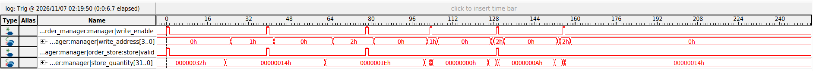

# FPGA market engine

A 16-slot SystemVerilog order book running on a Terasic DE0-Nano (Cyclone IV E, 50 MHz). A built-in replay controller sends six market messages. The engine adds orders, cancels them by ID, applies trades, and reports the best bid and ask.



Each write-enable pulse marks one update. Three adds are followed by a cancellation and two trades against the same sell order. The partial trade leaves 20 units in slot 2. The final trade clears its valid bit.

## Run the tests

Install Icarus Verilog and put iverilog and vvp on PATH. From PowerShell in the repository root, run:

```powershell
.\run_tests.ps1
```

The integration test covers price selection, cancellations, trades, capacity, last-slot reuse, rejected commands, backpressure and reset recovery.

## Replay on hardware

Open quartus/market_demo.qpf in Quartus Prime Lite with Cyclone IV support. Start a full compilation and use the Programmer with USB-Blaster to load output_files/market_board_top.sof. Press and release KEY[0] to replay. LED0 is the heartbeat, LED1 indicates pass, LED2 indicates failure and LED3 indicates the demo is busy.

To capture the writes, open quartus/market_capture.stp. Hold KEY[0], run SignalTap acquisition, then release the button when waiting for the trigger.

## Design

The parser decodes 128-bit messages. The order manager updates the store and hands its shared read port to the BBO engine for a 16-slot scan. The top module publishes both sides together when the scan completes. The board controller checks the expected results for each replayed message.
